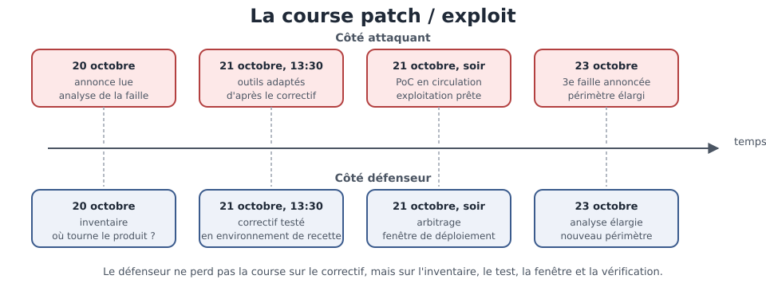

[← Chapitre précédent](04-erreurs-et-logging.md) · [Sommaire](Readme.md) · [Chapitre suivant →](06-revue-de-code-securite.md)

# Dépendances et configuration — ce qui tourne autour du code

> L'équipe data d'une mutuelle maintient un petit service d'export de rapports.
> Le lundi matin, l'analyse de dépendances signale une vulnérabilité dans une
> bibliothèque de mise en page de documents. Personne n'a écrit cette
> bibliothèque, personne ne l'a choisie : elle est arrivée avec une autre. Et
> pourtant, c'est votre service qui est exposé. Tu ne changes pas le monde — tu
> changes **ta version**.

**Durée de lecture :** 50 min hors approfondissements facultatifs · **Prérequis :** le cycle de vie d'une
vulnérabilité connue, et le chapitre
[XSS (Cross-Site Scripting) et sorties](03-xss-et-sorties.md)

---

## Objectifs

À l'issue de ce chapitre, vous serez capable de :

- **Lire** un avis de sécurité et en tirer ce qui concerne votre projet.
- **Évaluer** l'exposition réelle d'une dépendance signalée, avant de corriger.
- **Appliquer** un correctif de dépendance, tester l'absence de régression, et
  rétro-patcher si la mise à jour complète est impossible.
- **Durcir** la configuration d'un service : en-têtes de sécurité, mode debug,
  emplacement des secrets.

---

## I. SCA et réponse à une CVE

Le SCA (Software Composition Analysis) est l'analyse de ce que votre projet
**embarque** : bibliothèques, moteurs, outils de build. Un scanner SCA compare
la liste de vos dépendances aux bases de vulnérabilités connues et signale ce
qui est affecté.

Quand il sonne, la réaction se déroule en quatre temps :

| Étape | Ce qu'on fait | Ce qu'on cherche |
| --- | --- | --- |
| **Lire** | ouvrir l'avis de sécurité | la faille décrite, les versions concernées |
| **Situer** | regarder si le code vulnérable est appelé | l'exposition réelle, pas la simple présence |
| **Corriger** | monter la version, ou rétro-patcher | le plus petit changement qui ferme la faille |
| **Vérifier** | relancer les tests, rejouer le cas | l'absence de régression |

L'ordre compte. Corriger sans lire conduit à monter une version majeure qui
casse le service ; lire sans situer conduit à traiter en urgence une
dépendance qui n'est jamais exécutée.

**Rétro-patcher** applique le correctif de sécurité sur la version en place,
sans prendre le reste des changements : plus lourd à maintenir, donc
temporaire et daté.

Le schéma ci-dessous montre la même course vue des deux côtés — attaquant et défenseur — sur le calendrier de l'avis PHP repris en approfondissement de ce chapitre.



> 🧪 **Atelier rapide (10 min)**
>
> Dans le lab du cours, lancez un audit de dépendances sur le dossier `lab-securite/` —
> `pip-audit` pour Python, ou `trivy fs lab-securite/` pour un regard plus large. Notez
> les dépendances signalées, leur version installée et la version corrigée.
> Comparez avec le contenu de `lab-securite/cve/requirements.txt`, qui fige
> volontairement une version obsolète.

> 💡 **À retenir** — L'avis de sécurité décrit une faille de bibliothèque ;
> l'avis d'exposition décrit **votre** situation. Les deux se rédigent
> séparément, et c'est le second qui décide de l'urgence.

---

## II. En-têtes de sécurité

Le code écrit n'est pas le seul à décider de la sécurité d'une page : les
**en-têtes de réponse** disent au navigateur ce qu'il a le droit de faire. Ils
se posent une fois, au niveau du service, et couvrent toutes les routes.

```python
@app.middleware("http")
async def en_tetes_securite(request, call_next):
    response = await call_next(request)
    response.headers["X-Content-Type-Options"] = "nosniff"
    response.headers["X-Frame-Options"] = "DENY"
    response.headers["Content-Security-Policy"] = "default-src 'self'"
    response.headers["Strict-Transport-Security"] = "max-age=63072000"
    return response
```

| En-tête | Ce qu'il empêche |
| --- | --- |
| **Content-Security-Policy** | le chargement de ressources étrangères non voulues |
| **Strict-Transport-Security** | le retour en clair de la connexion |
| **X-Content-Type-Options** | l'interprétation d'un fichier selon un type qu'il n'a pas |
| **X-Frame-Options** | l'intégration de la page dans une page étrangère |

Le premier a été vu au chapitre précédent ; les trois autres suivent la même
logique : annoncer au navigateur une règle, plutôt que de compter sur le bon
comportement de chaque page.

> ⚠️ **Attention** — Un en-tête posé côté serveur se contourne si la page peut
> être servie ailleurs. La politique se vérifie depuis le client, sur la
> réponse réelle — pas depuis le fichier de configuration.

---

## III. Configuration durcie

La configuration est du code : elle s'écrit, se relit, se versionne. Trois
réflexes couvrent l'essentiel.

**Le mode debug reste en développement.** Un serveur en mode debug renvoie des
traces, des variables, parfois une console exécutable. C'est l'outil de travail
du développeur devenu, en production, une porte d'entrée.

**Les secrets vivent hors du code.** Un mot de passe écrit dans le dépôt est
copié dans chaque clone, chaque sauvegarde, chaque historique. Il se lit depuis
l'environnement d'exécution ou depuis un gestionnaire de secrets — et le code
ne contient que le nom de la variable.

```python
# le code nomme, l'environnement fournit
DB_PASSWORD = os.environ["DB_PASSWORD"]
```

**Les valeurs par défaut sont des valeurs.** Un secret de secours écrit dans le
code pour « faire tourner en local » finit par tourner en production. Une
configuration qui refuse de démarrer quand elle est incomplète est plus sûre
qu'une configuration qui devine.

| Ce qu'on durcit | Le geste |
| --- | --- |
| **Mode debug** | désactivé en production, vérifié au démarrage |
| **Secrets** | lus depuis l'environnement, jamais dans le dépôt |
| **Valeurs par défaut** | aucune valeur de secours en production |
| **Services inutiles** | routes de débogage supprimées, pas seulement masquées |

---

### Exercice 1 — Traiter une CVE sur son propre projet (25 min, facultatif)

#### Contexte

Votre équipe maintient un petit service d'export de rapports, utilisé par le
service marketing pour produire des fichiers de suivi. Le lundi matin, l'analyse
automatique des dépendances signale une vulnérabilité, décrite dans un avis
GHSA (GitHub Security Advisory) et référencée par un identifiant CVE (Common
Vulnerabilities and Exposures). Le fichier de figeage du
projet contient ceci :

```text
Flask==3.0.0
Jinja2==3.1.2
MarkupSafe==2.1.5
```

L'avis de sécurité, publié par l'éditeur, dit ceci :

| Champ | Contenu |
| --- | --- |
| **Identifiant** | CVE-2024-22195 — avis GHSA-h5c8-rqwp-cp95 |
| **Composant** | Jinja2, le moteur de gabarit |
| **Versions affectées** | antérieures à 3.1.3 |
| **Mécanisme** | le filtre `xmlattr` accepte des clés d'attribut contenant des espaces |
| **Impact** | injection de balise dans la page produite |

Le service utilise ce filtre pour assembler les attributs d'une liste de
résultats, à partir d'un dictionnaire dont une clé est fournie par la requête.

---

#### Consignes

##### Partie 1 — Lire l'avis

Reprenez les cinq champs de l'avis et dites, pour chacun, ce qu'il permet de
décider. Identifiez ce que l'avis **ne** dit pas et que vous devez établir
vous-même.

##### Partie 2 — Situer l'exposition

Cherchez dans le code du service si le filtre concerné est utilisé, et si les
clés du dictionnaire qu'il reçoit peuvent venir de l'extérieur. Concluez, en
deux phrases, sur l'exposition réelle du service — la présence de la
dépendance ne suffit pas à la trancher.

##### Partie 3 — Corriger

Appliquez le correctif : montez le composant vers la version corrigée, et
validez les clés côté applicatif pour que le mécanisme ne puisse pas se
reproduire sur une version ultérieure. Reconstruisez le service, puis vérifiez
que le cas décrit dans l'avis ne fonctionne plus.

##### Partie 4 — Rédiger l'avis d'exposition

Rédigez un court avis interne, à destination de l'équipe et de la direction des
systèmes d'information : la situation, l'exposition établie, la correction
appliquée, la vérification effectuée. Une dizaine de lignes suffit.

---

#### ✅ Auto-évaluation

- [ ] Je sais dire ce que chaque champ de l'avis apporte à la décision.
- [ ] J'ai identifié ce que l'avis ne dit pas et que le projet doit établir.
- [ ] J'ai vérifié si le filtre concerné est réellement utilisé par le service.
- [ ] Le composant est monté vers la version corrigée.
- [ ] Les clés sont validées côté applicatif, indépendamment de la version.
- [ ] J'ai vérifié que le cas de l'avis ne fonctionne plus après correction.
- [ ] Mon avis d'exposition tient en une dizaine de lignes et se passe de moi
      pour être compris.

---

#### Prolongement de l'exercice

*Facultatif — ne bloque pas la suite du parcours.*

La mise à jour complète n'était pas possible immédiatement : le service dépend
d'une bibliothèque qui exige une version antérieure. Décrivez la marche à suivre
pour rétro-patcher le composant concerné, ce que cela engage pour la
maintenance, et la date à laquelle ce choix devra être revu.

<details>
<summary>Voir la correction</summary>

> Comparez d'abord votre travail aux **étapes** ci-dessous : la méthode compte autant que le résultat.

#### Partie 1 — Lire l'avis

| Champ | Ce qu'il permet de décider |
| --- | --- |
| **Identifiant** | retrouver l'avis dans les bases, le citer dans vos propres documents |
| **Composant** | savoir quelle partie du projet est concernée |
| **Versions affectées** | dire si votre figeage est concerné, sans rien installer |
| **Mécanisme** | comprendre ce qui permet l'exploitation, et donc si vous l'exposez |
| **Impact** | estimer ce qui devient possible si personne ne corrige |

L'identifiant CVE (Common Vulnerabilities and Exposures) sert de référence
commune entre les bases ; l'avis GHSA (GitHub Security Advisory) est la
publication de l'éditeur, avec le détail du correctif.

Ce que l'avis **ne** dit pas, et que le projet doit établir lui-même :

- si la fonctionnalité concernée est réellement utilisée par votre code ;
- si les entrées qui déclenchent la faille sont atteignables depuis
  l'extérieur ;
- quel est l'impact métier, compte tenu des données traitées.

C'est la différence entre l'avis de sécurité et l'avis d'exposition : le premier
décrit une bibliothèque, le second décrit votre situation.

---

#### Partie 2 — Situer l'exposition

Le code du service utilise le filtre concerné pour assembler les attributs d'une
liste de résultats, et une des clés du dictionnaire vient de la requête. Le
mécanisme de l'avis est donc atteignable : la clé n'est pas validée, et le filtre
l'insère telle quelle dans la balise.

Conclusion en deux phrases : le service est exposé, et l'exposition est
directement déclenchable depuis la page de recherche. La simple présence de la
dépendance ne l'aurait pas établi — c'est l'usage du filtre, avec une clé venue
de l'extérieur, qui tranche.

---

#### Partie 3 — Corriger

Deux volets, indissociables :

```text
Jinja2==3.1.3
```

Le composant est monté vers la version corrigée. Et la validation des clés est
ajoutée côté applicatif :

```python
CLES_AUTORISEES = {"data-nom", "class"}


def valider_attributs(attributs):
    for cle in attributs:
        if cle not in CLES_AUTORISEES:
            raise ValueError("cle d'attribut non autorisee")
    return attributs
```

Le premier volet ferme la faille connue ; le second empêche qu'un mécanisme
voisin ne se reproduise sur une version ultérieure. S'en tenir à la mise à jour
aurait laissé la porte ouverte à la faille suivante du même type.

La vérification porte sur les deux points : les tests existants passent
toujours, et le cas décrit dans l'avis — une clé contenant des espaces — ne
produit plus d'attribut parasite dans la page.

---

#### Partie 4 — Rédiger l'avis d'exposition

Un avis interne tient en quelques lignes :

> **Objet** — vulnérabilité sur une dépendance du service d'export.
>
> **Situation** — le composant de mise en page est affecté par l'avis
> CVE-2024-22195, dans la version figée par le projet.
>
> **Exposition** — la fonctionnalité concernée est utilisée, avec une clé
> fournie par la requête : le service est exposé.
>
> **Correction** — montée du composant vers la version corrigée, et validation
> des clés côté applicatif.
>
> **Vérification** — les tests passent, le cas de l'avis ne fonctionne plus.

Cet avis se passe de son auteur : quelqu'un qui reprend le sujet comprend la
situation sans avoir à interroger l'équipe.

---

#### Points à retenir

- La réponse suit quatre temps : **lire, situer, corriger, vérifier** —
  corriger avant de lire conduit à des mises à jour qui cassent le service.
- L'avis de sécurité décrit la bibliothèque ; l'avis d'exposition décrit
  **votre** projet, et c'est lui qui décide de l'urgence.
- La mise à jour ferme la faille connue ; la validation des entrées ferme la
  suivante.
- La vérification a deux volets : les tests passent, et le cas de l'avis ne
  passe plus.

</details>

---

## IV. Aller plus loin

*Ces approfondissements sont facultatifs : ils ne sont jamais exigés pour
terminer la journée.*

- **Le SBOM** (Software Bill of Materials) — la liste de ce que contient un
  logiciel, dans un format standard. Quand une vulnérabilité est annoncée, le
  SBOM répond en quelques secondes à la question « sommes-nous concernés ? » —
  au lieu d'une recherche manuelle dans les fichiers de dépendances.
- **La veille automatisée** — les plateformes d'hébergement ouvrent des demandes
  de mise à jour dès qu'un avis concerne le projet. C'est utile, à condition de
  lire l'avis avant de fusionner : une mise à jour automatique qui casse le
  service n'est pas une sécurité.
- **Les politiques de version** — figer les versions interdites, imposer une
  plage de versions corrigées, refuser les dépendances abandonnées : autant de
  règles qui se vérifient à chaque build, plutôt qu'à chaque incident.

> 🔁 **Pour aller plus loin (facultatif)** — à lire si le créneau le permet, rien
> d'obligatoire n'en dépend
>
> Ces deux volets détaillent les lignes « Corriger » et « Vérifier » du tableau
> ci-dessus.
>
> **Corriger et vérifier**
>
>
> Le correctif le plus sûr est la mise à jour vers la version corrigée. Quand elle
> n'est pas possible — dépendance majeure, compatibilité cassée — on
> **rétro-patche** : on applique le correctif de sécurité sur la version en place,
> sans prendre le reste des changements. C'est plus lourd à maintenir, donc
> temporaire, et daté.
>
> La vérification a deux volets : les tests existants passent toujours, et le cas
> décrit dans l'avis ne passe plus. L'un sans l'autre ne prouve rien.

> 🔁 **Pour aller plus loin (facultatif)** — à lire si le créneau le permet, rien
> d'obligatoire n'en dépend
>
> Ces trois questions détaillent la ligne « Situer » du tableau ci-dessus.
>
> **Situer l'exposition**
>
>
> La présence d'une dépendance vulnérable n'est pas l'exposition. Trois questions
> tranchent :
>
> - **La fonctionnalité concernée est-elle appelée ?** Une bibliothèque entière
>   peut être installée pour une seule fonction, saine.
> - **Les entrées de la faille sont-elles atteignables ?** Une faille déclenchée
>   par un champ administratif n'a pas le même poids que celle déclenchée par
>   n'importe quelle requête.
> - **Quel est l'impact métier ?** Les données concernées, l'exposition du
>   service, la possibilité de reprendre la main.

> 🔁 **Pour aller plus loin (facultatif)** — à lire si le créneau le permet, rien
> d'obligatoire n'en dépend
>
> Ce cas PHP a déjà été ouvert à la journée sur les vulnérabilités ; il
> illustre les quatre informations à retirer d'un avis.
>
> **Lire un avis de sécurité**
>
>
> Un avis se lit pour quatre informations : l'identifiant, la gravité, les
> versions affectées, et le mécanisme. Exemple, sur le cas réel de PHP (Hypertext Preprocessor) en octobre
> 2026 — l'advisory 2026-018 du CERT (Computer Emergency Response Team)
> européen :
>
> | Information | Ce qu'elle dit |
> | --- | --- |
> | **Identifiant** | un numéro d'avis, et les CVE (Common Vulnerabilities and Exposures) associées |
> | **Gravité** | un score CVSS (Common Vulnerability Scoring System), ici 9.2 sur 10 |
> | **Versions** | ce qui est affecté, ce qui est corrigé |
> | **Mécanisme** | deux exécutions de code à distance non authentifiées |
>
> Le calendrier de cet avis est instructif : annonce le 20 octobre, correctif le
> 21, preuve de concept en circulation dans la foulée, troisième faille annoncée
> le 23. Le temps de correction se compte en heures ; le temps d'exploitation, en
> minutes. C'est pour cela que « lire l'avis » n'est pas une lecture de fin de
> journée.

---

## Points clés

- La réponse à une vulnérabilité suit quatre temps : **lire, situer, corriger,
  vérifier** — dans cet ordre.
- La présence d'une dépendance n'est pas l'exposition : c'est **l'appel réel**
  du code concerné qui décide de l'urgence.
- Les en-têtes de sécurité se posent **côté serveur**, une fois, et se
  vérifient depuis le client.
- Une configuration durcie : **debug off**, secrets hors du code, aucune valeur
  de secours en production.

---

## 🧠 Vérifiez vos acquis

*Formatif, jamais noté. Répondez sans relire le chapitre, puis dépliez « Vérifier ses réponses » : ce qui compte est de repérer où vous vacillez, pas de faire 5 sur 5.*

**1.** Le scanner signale une vulnérabilité dans une bibliothèque. L'équipe corrige immédiatement, sans lire l'avis de sécurité. Quel risque prend-elle ?

- A. Aucun : corriger vite est toujours la bonne réponse
- B. De monter une version majeure qui casse le service
- C. De laisser la dépendance abandonnée dans le projet
- D. D'oublier de prévenir les utilisateurs de la faille

**2.** Une dépendance est signalée vulnérable, mais la fonction concernée n'est jamais appelée par le service. Que dit le chapitre ?

- A. La présence de la dépendance n'est pas l'exposition : c'est l'appel réel du code concerné qui décide de l'urgence
- B. Il faut traiter en priorité absolue : toute dépendance présente est une faille ouverte
- C. Il faut supprimer la bibliothèque immédiatement, appelée ou non
- D. Il faut ignorer le signal : une dépendance non appelée est inoffensive par nature

**3.** La mise à jour vers la version corrigée est impossible (compatibilité cassée). Que fait un rétro-patch ?

- A. Il remplace la bibliothèque par une autre, plus légère et sans cette faille, en réécrivant les appels qui en dépendent
- B. Il applique le correctif de sécurité sur la version en place, sans les autres changements, temporairement et en le datant
- C. Il désactive la bibliothèque concernée le temps que l'éditeur publie un correctif, quitte à perdre la fonctionnalité
- D. Il fige la version actuelle dans le fichier de verrouillage et attend la prochaine version majeure de la bibliothèque

**4.** On veut empêcher que la page soit intégrée dans une page étrangère. Quel en-tête de réponse le permet ?

- A. X-Content-Type-Options
- B. Strict-Transport-Security
- C. Content-Security-Policy
- D. X-Frame-Options

**5.** *Question ouverte (2-3 lignes).* « Une configuration qui refuse de démarrer quand elle est incomplète est plus sûre qu'une configuration qui devine. » Expliquez avec l'exemple du secret de secours écrit « pour faire tourner en local ».

---

<details>

<summary>Vérifier ses réponses</summary>

### Réponses

**1. B.** L'ordre compte : lire, situer, corriger, vérifier. Corriger sans lire, c'est monter une version majeure qui casse le service.
**Pourquoi :** lire l'avis dit quelles versions sont concernées et quel est le plus petit changement qui ferme la faille.

**2. A.** La présence n'est pas l'exposition : lire sans situer conduit à traiter en urgence une dépendance qui n'est jamais exécutée.
**Pourquoi :** l'avis de sécurité décrit une faille de bibliothèque ; l'avis d'exposition décrit votre situation, et c'est le second qui décide de l'urgence.

**3. B.** Rétro-patcher = appliquer le correctif de sécurité sur la version en place, sans prendre le reste des changements.
**Pourquoi :** c'est plus lourd à maintenir, donc temporaire et daté — le temps de rendre la montée de version possible.

**4. D.** X-Frame-Options empêche l'intégration de la page dans une page étrangère.
**Pourquoi :** chaque en-tête annonce au navigateur une règle — Strict-Transport-Security borne le retour en clair, X-Content-Type-Options bloque l'interprétation d'un fichier selon un type qu'il n'a pas ; et la politique se vérifie depuis le client, sur la réponse réelle.

**5.** Attendu : un secret de secours écrit dans le code pour le confort du développement finit par tourner en production — les valeurs par défaut sont des valeurs. Le comportement sûr : lire le secret depuis l'environnement d'exécution ou un gestionnaire de secrets, et laisser la configuration refuser de démarrer plutôt que deviner.
**Pourquoi :** un mot de passe écrit dans le dépôt est copié dans chaque clone, chaque sauvegarde, chaque historique ; le code ne doit contenir que le nom de la variable.

</details>

---

[← Chapitre précédent](04-erreurs-et-logging.md) · [Sommaire](Readme.md) · [Chapitre suivant →](06-revue-de-code-securite.md)
