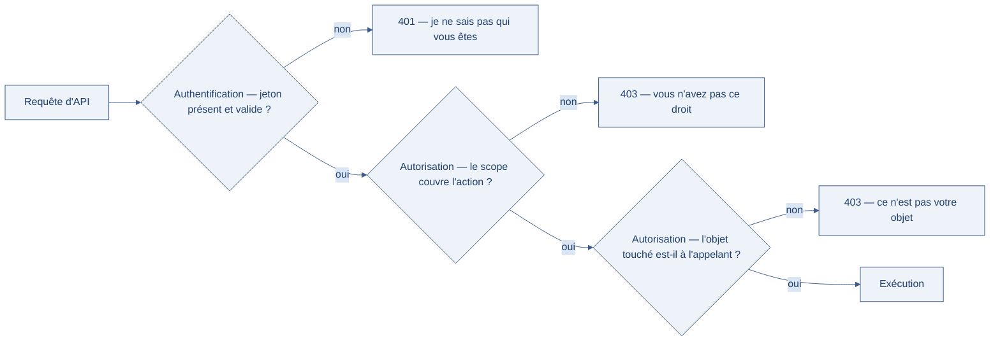

[← Chapitre précédent](07-securite-api.md) · [Sommaire](Readme.md) · [Chapitre suivant →](09-donnees-sensibles.md)

# Auth et limitation d'API — qui appelle, et à quelle vitesse

> L'API de billetterie d'une salle de spectacle est publique : n'importe qui peut
> consulter les places disponibles. Un script y envoie 10 000 requêtes par
> minute. L'API, elle, tient — mais la base de données est à genoux, et les
> vrais spectateurs reçoivent des pages qui ne chargent plus. Authentifier
> l'appelant n'est pas le tout : il faut aussi **limiter son débit** et
> **valider ses données**.

**Durée de lecture :** 45 min hors approfondissements facultatifs · **Prérequis :** le chapitre [Sécurité des API](07-securite-api.md)

---

## Objectifs

À l'issue de ce chapitre, vous serez capable de :

- **Distinguer** ce qu'un jeton autorise (scopes et rôles) de ce qu'il prouve
  (identité).
- **Appliquer** un rate limiting adapté à chaque endpoint d'une API.
- **Écrire** une validation de schéma qui refuse les valeurs hors cadre.
- **Choisir** un niveau de quota par consommateur d'API.

---

## I. Scopes et rôles

Authentifier, c'est répondre à la question « **qui** appelle ? ». Autoriser,
c'est répondre à « **qu'a-t-il le droit de faire** ? ». Le chapitre précédent
montrait que confondre les deux produit du BOLA (Broken Object Level Authorization) ; ici, on construit la réponse.

Deux outils se complètent :

| Outil | Ce qu'il décrit | Exemple |
| --- | --- | --- |
| **Le rôle** | le profil de l'appelant dans le système | `spectateur`, `guichet`, `administrateur` |
| **Le scope** | le périmètre exact accordé à **cet** appel | `places:lire`, `places:reserver`, `remboursements:creer` |

Le rôle est large et stable ; le scope est fin et révocable. Un jeton de
billetterie délivré à une application partenaire peut porter le rôle
`guichet` avec le seul scope `places:lire` : l'application voit les places,
sans jamais pouvoir en réserver ni en rembourser.

Notez la différence entre les deux codes de refus : `401 Unauthorized` dit « je ne sais
pas qui vous êtes » (ou votre jeton ne vaut plus rien) ; `403 Forbidden` dit
« je sais qui vous êtes, et vous n'avez pas ce droit ». Un code `403` renvoyé
à la place d'un `401` — ou l'inverse — est le premier indice d'une autorisation
mal branchée.

Le schéma ci-dessous ordonne les trois portes d'une requête d'API et attache un code de refus à chacune :



---

## II. Rate limiting

Le rate limiting (limitation de débit) fixe **combien de requêtes** un appelant
peut faire **dans un intervalle**. Il protège trois choses à la fois : la
disponibilité du service, la base de données derrière, et le portefeuille (chaque
appel coûte des ressources).

Trois décisions se prennent dès qu'on pose un rate limiting :

| Décision | Options | Ce qu'elle change |
| --- | --- | --- |
| **Qui compte ?** | adresse IP, compte, clé d'application | une IP partagée (entreprise, campus) ne doit pas être punie pour tous ses utilisateurs |
| **Quel rythme ?** | par seconde, par minute, par jour | un login se limite serré ; une lecture de catalogue se limite large |
| **Que renvoyer ?** | `429 Too Many Requests` + en-tête `Retry-After` | l'appelant sait quand réessayer au lieu de marteler |

> [!WARNING]
> Un compteur tenu en mémoire repart à zéro à chaque redémarrage
> du service et n'est pas partagé entre plusieurs instances. C'est parfait pour
> un premier garde-fou, insuffisant pour une API exposée : le comptage se
> déplace alors vers un stockage partagé (Redis, base de données) ou vers la
> passerelle d'API.

---

## III. Validation de schéma

Un appelant envoie ce qu'il veut : un champ de trop, une chaîne à la place d'un
nombre, une valeur négative pour une quantité. La validation de schéma décrit
**à l'avance** la forme acceptable de chaque requête, et refuse le reste.

En Python, Pydantic est le standard de fait avec FastAPI :

```python
from pydantic import BaseModel, Field

class Reservation(BaseModel):
    spectacle_id: int
    places: int = Field(ge=1, le=6)                    # entre 1 et 6 places
    email: str = Field(max_length=254)                 # longueur bornée
    code_postal: str = Field(pattern=r"^\d{5}$")       # format exact
```

Le réflexe est **fail-closed** : ce qui n'est pas explicitement accepté est
refusé, jamais « réparé » en silence. Une API qui transforme `places=-3` en
`places=1` cache un bug du côté de l'appelant — et lui apprend à ne jamais le
corriger.

> [!DANGER]
> Valider le format ne suffit pas : il faut aussi vérifier **l'autorisation**
> sur la donnée touchée. Une réservation parfaitement validée au schéma peut
> porter un `spectacle_id` qui n'appartient pas à l'appelant — c'est du BOLA,
> et la validation de schéma ne le voit pas.

---

## IV. Aller plus loin

*Ces approfondissements sont facultatifs : ils ne sont jamais exigés pour
terminer la journée.*

- **Quotas par consommateur** — au-delà du débit instantané, un budget sur la
  journée ou le mois : 100 appels par heure pour l'application partenaire A,
  10 000 pour le partenaire B. Les API publiques (météo, transports, cartographie)
  fonctionnent ainsi, avec un en-tête qui annonce le budget restant.
- **Passerelle d'API (API gateway)** — un composant (Kong, Apigee, ou les
  passerelles cloud) qui applique authentification, rate limiting et validation
  **avant** le code applicatif. Centralisé et homogène — mais il ne dispense pas
  l'application de vérifier l'autorisation sur chaque objet.
- **JWT (JSON Web Token)** — le format de jeton le plus répandu dans les API :
  un en-tête, une charge utile (les scopes, l'identité), une signature. Ses
  scopes sont lus **sans appel à la base** — d'où l'importance de les écrire
  serrés au moment de la délivrance, puisqu'un jeton émis vit jusqu'à son
  expiration.

> 🔁 **Pour aller plus loin (facultatif)** — à lire si le créneau le permet, rien d'obligatoire n'en dépend
>
> **La matrice endpoint × scope, exemple complet**
>
> Le principe — rôle large, scope fin — est dans le tableau ci-dessus ; cette matrice n'en est qu'une application, que l'exercice reprend à son compte.
>
> Deux verbes HTTP suffisent pour l'exemple : GET (consulter une ressource) et
> POST (en créer une). La règle d'or se vérifie endpoint par endpoint :
>
> | Endpoint | Scope exigé | Refus attendu sans ce scope |
> | --- | --- | --- |
> | `GET /places` | `places:lire` | `401` si pas de jeton, `403` si jeton sans ce scope |
> | `POST /reservations` | `places:reserver` | `403` |
> | `POST /remboursements` | `remboursements:creer` | `403` |

> 🔁 **Pour aller plus loin (facultatif)** — à lire si le créneau le permet, rien d'obligatoire n'en dépend
>
> **Écrire la matrice avant le code**
>
> Conseil de méthode pour celui qui rédige la sienne ; rien dans la journée ne le suppose appliqué.
>
> Écrivez la matrice « endpoint × scope » **avant** d'écrire le code des
> contrôleurs. Une autorisation décidée au cas par cas, endpoint après
> endpoint, finit toujours par en oublier un.

> 🔁 **Pour aller plus loin (facultatif)** — à lire si le créneau le permet, rien d'obligatoire n'en dépend
>
> Le même point que la section I, illustré : la distinction 401/403 y est déjé noncée, cet atelier ne fait que la montrer.
>
> 🧪 **Atelier rapide (5 min)**
>
> Voici deux réponses de la même API, pour le même endpoint administratif.
> Identifiez, pour chacune, **quel contrôle** a produit le refus :
>
> ```text
> Requête A — sans en-tête Authorization
> HTTP/1.1 401 Unauthorized
> {"detail": "token manquant"}
>
> Requête B — avec un jeton valide de scope "places:lire"
> HTTP/1.1 403 Forbidden
> {"detail": "accès réservé aux remboursements"}
> ```
>
> La requête A échoue à l'**authentification** (personne n'est identifié) ; la
> requête B échoue à l'**autorisation** (l'appelant est identifié, mais son scope
> ne couvre pas l'action). Vérifiez que vous pouvez expliquer cette différence à
> quelqu'un sans relire la section I.

> 🔁 **Pour aller plus loin (facultatif)** — à lire si le créneau le permet, rien d'obligatoire n'en dépend
>
> **Le compteur minimal, en Python**
>
> Amorce d'écriture : les trois décisions à prendre et les limites du procédé restent dans la section II, qui les énonce sans ce code.
>
> Le cas le plus simple est un compteur par appelant :
>
> ```python
> # Compteur minimal de tentatives — clair, mais limité (voir la section II).
> TENTATIVES: dict[str, int] = {}
> MAX_TENTATIVES = 5
>
> def verifier_quota(cle: str) -> bool:
>     if TENTATIVES.get(cle, 0) >= MAX_TENTATIVES:
>         return False          # la requête sera refusée en 429
>     TENTATIVES[cle] = TENTATIVES.get(cle, 0) + 1
>     return True
> ```

> 🔁 **Pour aller plus loin (facultatif)** — à lire si le créneau le permet, rien d'obligatoire n'en dépend
>
> **Ce que chaque contrainte tranche**
>
> Le code ci-dessus porte déjà ces quatre contraintes ; la table les nomme, elle n'ajoute rien à faire.
>
> Chaque contrainte répond à une question simple :
>
> | Contrainte | Question qu'elle tranche | Ce qu'elle écarte |
> | --- | --- | --- |
> | **Type** (`int`, `str`) | la valeur est-elle du bon type ? | `"six"` à la place de `6` |
> | **Bornes** (`ge`, `le`) | la valeur est-elle plausible ? | `-3` places, `999` places |
> | **Longueur** (`max_length`) | la saisie est-elle dimensionnée ? | un champ de commentaire de 10 Mo |
> | **Format** (`pattern`) | la valeur suit-elle le schéma attendu ? | un code postal qui n'en est pas un |

> 🔁 **Pour aller plus loin (facultatif)** — à lire si le créneau le permet, rien d'obligatoire n'en dépend
>
> **Limiter la taille, pas seulement le débit**
>
> La section III en fait un cas ordinaire du schéma : `max_length` sur un champ, c'est cette limite posée à l'avance.
>
> Le débit n'est pas la seule ressource à limiter : la **taille** des requêtes
> aussi. Un corps de requête de 50 Mo, un champ de recherche de 10 000
> caractères, une réponse paginée sans limite — chacun est un levier d'épuisement.
> La section suivante traite ces cas.

---

## Points clés

- Authentifier répond à « qui ? », autoriser à « quoi ? » : **rôles** pour le
  profil, **scopes** pour le périmètre exact de chaque appel.
- `401` = je ne sais pas qui vous êtes ; `403` = je sais, et vous n'avez pas ce
  droit. Le bon code renvoyé est déjà une information de sécurité.
- Le rate limiting protège la disponibilité, la base et le budget : on décide
  **qui compte**, **quel rythme**, **que renvoyer** (`429` + `Retry-After`).
- La validation de schéma tranche à l'avance types, bornes, longueurs et
  formats — et refuse par défaut. Elle ne remplace jamais le contrôle
  d'autorisation sur l'objet touché.

---

## 🧠 Vérifiez vos acquis

*Formatif, jamais noté. Répondez sans relire le chapitre, puis dépliez « Vérifier ses réponses » : ce qui compte est de repérer où vous vacillez, pas de faire 5 sur 5.*

**1.** Un jeton de billetterie porte le rôle `guichet` avec le seul scope `places:lire`. Que peut faire l'application partenaire qui le détient ?

- A. Réserver des places, mais pas les rembourser
- B. Consulter les places, sans jamais pouvoir en réserver ni en rembourser
- C. Tout ce que fait un guichetier : le rôle décide seul
- D. Rien : sans les deux scopes, le jeton ne vaut plus rien

**2.** Une requête arrive avec un jeton valide, mais dont le scope ne couvre pas l'action demandée. Quel code de refus est le bon ?

- A. `401 Unauthorized`, puisqu'il manque quelque chose
- B. `403 Forbidden` : l'appelant est identifié, mais n'a pas ce droit
- C. `429 Too Many Requests` : l'action est hors périmètre
- D. `404 Not Found` : l'action ne doit pas être visible

**3.** Le rate limiting est compté en mémoire dans le service. Pourquoi est-ce insuffisant pour une API exposée ?

- A. Parce que compter en mémoire serait trop lent pour tenir sous une charge réelle de plusieurs milliers d'appels
- B. Parce que le compteur repart à zéro à chaque redémarrage et n'est pas partagé entre les instances du service
- C. Parce qu'il faut compter les adresses IP et jamais les comptes, qui changent de titulaire sur un poste partagé
- D. Parce qu'un compteur tenu en mémoire ne serait plus capable de renvoyer le code `429` à l'appelant trop rapide

**4.** L'API reçoit `places=-3` et le transforme en `places=1` pour que la requête passe. Quel principe est bafoué ?

- A. Aucun : c'est exactement ce que fait une validation de schéma bien comprise, qui accepte et complète le corps reçu
- B. La limitation de débit : l'appelant martèle l'API et finit par obtenir l'écriture de ce champ en trop
- C. Le fail-closed de la validation de schéma : ce qui n'est pas explicitement accepté est refusé, jamais « réparé » en silence
- D. L'autorisation : la réservation ne porte pas le bon `spectacle_id` et devrait échouer au contrôle d'accès

**5.** *Question ouverte (2-3 lignes).* « Valider le format ne suffit pas. » Expliquez pourquoi une réservation parfaitement valide au schéma peut quand même être une faille, et nommez le risque.

---

<details>

<summary>Vérifier ses réponses</summary>

### Réponses

**1. B.** Le rôle décrit le profil de l'appelant ; le scope borne le périmètre exact de cet appel : avec `places:lire` seul, l'application voit les places, sans pouvoir réserver ni rembourser.
**Pourquoi :** le rôle est large et stable, le scope est fin et révocable — c'est lui qui décide au moment de l'appel.

**2. B.** `401` dit « je ne sais pas qui vous êtes » (ou votre jeton ne vaut plus rien) ; `403` dit « je sais qui vous êtes, et vous n'avez pas ce droit ».
**Pourquoi :** un `403` renvoyé à la place d'un `401` — ou l'inverse — est le premier indice d'une autorisation mal branchée.

**3. B.** Un compteur en mémoire repart à zéro à chaque redémarrage et n'est pas partagé entre plusieurs instances : parfait comme premier garde-fou, insuffisant pour une API exposée.
**Pourquoi :** le comptage se déplace alors vers un stockage partagé (Redis, base de données) ou vers la passerelle d'API ; on décide aussi qui compte (une IP partagée ne doit pas être punie pour tous ses utilisateurs) et quel rythme (un login se limite serré, une lecture de catalogue large).

**4. C.** Une API qui transforme `places=-3` en `places=1` cache un bug du côté de l'appelant — et lui apprend à ne jamais le corriger.
**Pourquoi :** la validation de schéma tranche à l'avance types, bornes, longueurs et formats, et refuse par défaut : le refus est la correction honnête.

**5.** Attendu : le schéma vérifie la forme (type, bornes, longueur, format), pas le droit d'usage ; une réservation validée peut porter un `spectacle_id` qui n'appartient pas à l'appelant — c'est du BOLA (Broken Object Level Authorization), et la validation de schéma ne le voit pas.
**Pourquoi :** la forme et le droit sont deux contrôles distincts : il faut aussi vérifier l'autorisation sur la donnée touchée.

</details>

---

[← Chapitre précédent](07-securite-api.md) · [Sommaire](Readme.md) · [Chapitre suivant →](09-donnees-sensibles.md)
