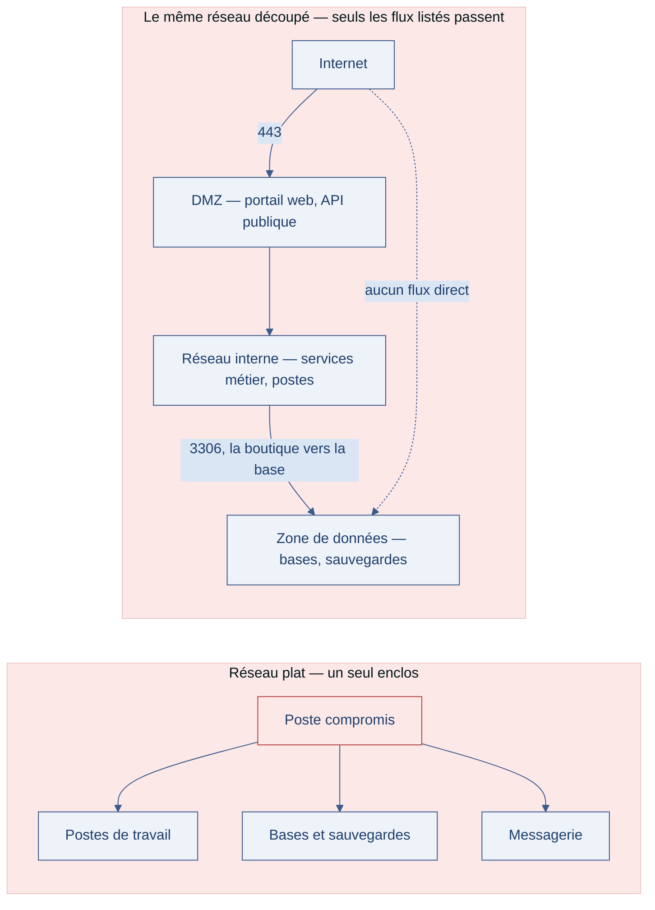

[← Chapitre précédent](13-protocoles-reseau.md) · [Sommaire](Readme.md) · [Chapitre suivant →](15-devsecops.md)

# Architecture réseau — segmenter, cloisonner, ne rien croire sur parole

> Au début, le réseau de l'éditeur tenait en une image : une forteresse, un mur,
> et derrière, la paix. Le mur, c'était le pare-feu. Puis sont arrivés le cloud,
> le télétravail, les API tierces de paiement et d'expédition, les prestataires,
> les objets connectés. Le mur n'a pas disparu — il est devenu poreux, et personne
> ne sait plus très bien où il passe. C'est là qu'une autre idée a émergé : ne plus
> faire confiance à la position d'une machine, mais à ce qu'elle prouve.

**Durée de lecture :** 70 min hors approfondissements facultatifs · **Prérequis :** le chapitre
[Protocoles réseau](13-protocoles-reseau.md), les notions de pare-feu

---

## Objectifs

À l'issue de ce chapitre, vous serez capable de :

- **Découper** une architecture applicative en zones de confiance distinctes.
- **Situer** chaque composant d'une application dans la zone qui correspond à son
  exposition réelle.
- **Appliquer** le principe de vérification permanente à des flux applicatifs :
  authentifier chaque appel, pas seulement chaque connexion.
- **Choisir** un point d'entrée unique contrôlé pour une famille d'API.

---

## I. Segmentation et zone tampon

### L'idée de départ : le mur

Le réseau d'entreprise classique repose sur une frontière nette : dehors, c'est
hostile ; dedans, c'est sûr. Un pare-feu périmétrique garde la porte, et tout ce
qui est à l'intérieur peut parler à tout le reste. Ce modèle a fonctionné tant que
les applications vivaient au même endroit que les utilisateurs.

Il tient mal aujourd'hui pour trois raisons simples :

- **les données se sont éloignées** — elles vivent chez un hébergeur, dans un
  service de stockage, dans un entrepôt partagé ;
- **les utilisateurs se sont éloignés** — un poste de télétravail est à la fois
  chez vous et sur un réseau domestique ;
- **les applications parlent à l'extérieur** — paiement, expédition, cartographie,
  notifications : chaque API tierce est une porte qui s'ouvre dans les deux sens.

Dès qu'un seul poste de l'intérieur est compromis, le réseau plat offre à
l'attaquant tout le reste sans effort.

### La réponse : des zones, et des flux explicites

La segmentation découpe le réseau en zones selon la **confiance** qu'on accorde à
ce qui s'y trouve, et n'autorise entre les zones que les flux écrits noir sur
blanc. La zone tampon — la DMZ (demilitarized zone, la zone intermédiaire entre
l'extérieur et l'intérieur) — reçoit ce qui doit être visible de l'extérieur,
sans que rien de sensible n'y vive.

Le schéma ci-dessous montre les deux situations côte à côte : à gauche, un poste
compromis dans un réseau plat joint tout le reste ; à droite, le même réseau
découpé, où ne traverse que ce qui est écrit noir sur blanc, avec son port.

Trois zones suffisent le plus souvent. Ce qui compte n'est pas le nombre, c'est
la règle qui va avec : **entre deux zones, seuls les flux listés passent**. Un
flux oublié est refusé, pas ouvert par défaut.

> 💡 **Astuce** —
> Pour placer un composant, posez une seule question : « depuis où doit-on pouvoir
> le joindre ? ». La réponse donne la zone. Une base de données joignable depuis
> Internet est un placement faux, quel que soit le pare-feu autour.

> 🧪 **Atelier rapide (5 min)**
>
> Le lab de test expose trois services : `vulnerable` (l'API volontairement
> faillible), `secure` (la même API corrigée) et `db` (la base de données).
> Sur un papier, schématisez une architecture segmentée et placez ces trois
> services. Combien de flux traverse chaque frontière ? Lequel de ces flux
> n'a aucune raison d'exister ?

---

## II. Zero Trust : ne jamais faire confiance, toujours vérifier

### Le changement de regard

La segmentation dit « l'intérieur est plus sûr que l'extérieur ». Le principe
Zero Trust (confiance zéro) pousse l'idée jusqu'au bout : **la position sur le
réseau ne prouve rien**. Un poste du réseau interne peut être compromis, un
service hébergé peut être détourné, un compte peut être volé. Chaque appel doit
donc prouver qui il est et ce qu'il a le droit de faire, à chaque fois.

Concrètement, cela revient à appliquer au réseau ce que le moindre privilège
applique au code — la règle de proportionnalité rencontrée dès la première
journée du parcours :

| Ancien réflexe | Réflexe Zero Trust |
| --- | --- |
| « cette machine est dans le réseau, elle est digne de confiance » | « cette machine présente un jeton valide, vérifions ce qu'elle demande » |
| « on s'authentifie une fois, à l'entrée » | « chaque appel est authentifié et autorisé, y compris entre services internes » |
| « le trafic interne n'a pas besoin d'être chiffré » | « le trafic est chiffré partout, y compris entre deux services du même réseau » |
| « le périmètre définit les droits » | « les droits suivent l'identité et la donnée demandée » |

### Ce que ça change pour une application data

Prenons une chaîne classique : un planificateur de tâches déclenche un script
d'extraction, qui lit une base source, écrit dans un stockage objet, qu'un service
de restitution expose ensuite par une API. Dans un réseau plat, la moindre étape
compromise donne accès à toute la chaîne. En Zero Trust :

- chaque maillon s'authentifie avec **sa propre identité** (un compte de service,
  pas un mot de passe partagé) ;
- chaque maillon ne reçoit que **ses droits** : le script d'extraction lit la base
  source et écrit dans le stockage, rien d'autre ;
- les échanges entre maillons sont **chiffrés**, même au sein du même réseau ;
- les appels sont **journalisés**, pour qu'un dérangement se voie.

---

## III. L'API Gateway : un point d'entrée unique

Quand une application expose plusieurs API, multiplier les points d'entrée
multiplie les oublis : une limitation de débit oubliée ici, une journalisation
absente là, une version ancienne laissée ouverte ailleurs. L'API Gateway (la
passerelle d'API) rassemble les contrôles communs à un seul endroit.

Ce qu'elle prend en charge, une fois pour toutes :

| Contrôle | Ce qu'il apporte |
| --- | --- |
| **Authentification de l'appelant** | vérifier le jeton de chaque requête avant qu'elle n'atteigne le service |
| **Autorisation** | refuser ce que le rôle de l'appelant ne couvre pas |
| **Limitation de débit** | empêcher un appelant d'asphyxier les services derrière |
| **Journalisation** | tracer qui appelle quoi, depuis où, et à quelle fréquence |
| **Routage et versions** | diriger vers la bonne version, et retirer proprement les anciennes |

Les services derrière la passerelle n'ont alors plus qu'à faire leur métier. Ils
restent protégés même si l'un d'eux contient une faille : il n'est joignable que
par la passerelle, avec les droits qu'elle accorde.

---

## IV. Aller plus loin

*Ces approfondissements sont facultatifs : ils ne sont jamais exigés pour terminer
la journée.*

- **SASE et SSE** — SASE (Secure Access Service Edge, l'architecture qui fusionne
  réseau et sécurité dans un service unique) et SSE (Security Service Edge, sa
  partie sécurité) déplacent ces contrôles vers un service commun, adapté aux
  équipes dispersées et aux applications hébergées partout.
- **La micro-segmentation** — descendre la segmentation jusqu'au service ou au
  conteneur, avec des règles de flux calculées automatiquement. Puissant, mais
  exigeant à tenir dans le temps.
- **Le modèle de maturité Zero Trust** — plusieurs cadres publics décrivent des
  jalons progressifs. Ils servent de boussole pour prioriser, pas de certification
  à obtenir.

> 🔁 **Pour aller plus loin (facultatif)** — à lire si le créneau le permet, rien d'obligatoire n'en dépend
>
> ⚠️ **Point d'attention** —
> Zero Trust n'est pas un produit qu'on achète, ni un projet qu'on finit. C'est
> une direction : on l'applique d'abord là où la donnée est la plus sensible, puis
> on étend. Une équipe qui tente de tout convertir d'un coup n'achève rien.

> 🔁 **Pour aller plus loin (facultatif)** — à lire si le créneau le permet, rien d'obligatoire n'en dépend
>
> 🧭
> **Progression :** la difficulté monte **en continu**. La segmentation pose les
> zones, Zero Trust change la règle de confiance, la passerelle applique cette
> règle à chaque appel. Chaque idée reprend là où la précédente s'est arrêtée.

---

## Points clés

- Le réseau plat fait de chaque poste compromis une clé universelle : la
  **segmentation** découpe le réseau en zones et n'autorise que les flux écrits.
- La **DMZ** reçoit ce qui doit être visible de l'extérieur ; la zone de données
  ne reçoit, elle, que ce qui en a strictement besoin.
- **Zero Trust** : la position sur le réseau ne prouve rien — chaque appel prouve
  son identité et ses droits, y compris entre services internes.
- L'**API Gateway** rassemble authentification, autorisation, limitation de débit
  et journalisation à un point d'entrée unique, contrôlé.

---

## 🧠 Vérifiez vos acquis

*Formatif, jamais noté. Répondez sans relire le chapitre, puis dépliez « Vérifier ses réponses » : ce qui compte est de repérer où vous vacillez, pas de faire 5 sur 5.*

**1.** Pourquoi le modèle « un pare-feu, un mur, et derrière la paix » tient-il mal aujourd'hui ?

- A. Parce que les pare-feu modernes sont devenus moins fiables qu'à leurs débuts et laissent passer davantage
- B. Parce que données, utilisateurs et API tierces ont quitté le périmètre : un poste interne compromis offre tout le reste sur un réseau plat
- C. Parce que le pare-feu périmétrique est aveugle sur le trafic chiffré et ne peut donc plus rien filtrer d'utile
- D. Parce que la réglementation interdit le télétravail sur des postes manipulant des données personnelles

**2.** Dans une architecture segmentée, que met-on dans la DMZ (zone tampon) ?

- A. Les bases de données, qu'on protège au centre du dispositif, derrière tous les autres composants
- B. Ce qui doit être visible de l'extérieur — portail web, API publique — sans que rien de sensible n'y vive
- C. Les sauvegardes, qu'on isole du réseau de production pour les mettre à l'abri d'une rançongiciel
- D. Les postes de travail des développeurs, qui concentrent l'accès au code et aux secrets de service

**3.** Pour placer un composant dans une zone, le chapitre pose une seule question. Laquelle ?

- A. « Combien ce composant coûte-t-il à héberger, et pourrait-on le déplacer vers une offre moins chère ? »
- B. « Depuis où doit-on pouvoir le joindre ? » — une base de données joignable depuis Internet est mal placée, quel que soit le pare-feu autour
- C. « Qui a écrit ce composant, et son éditeur est-il encore actif pour publier des correctifs ? »
- D. « Ce composant est-il compatible avec le pare-feu en place et avec la supervision existante ? »

**4.** Que change le principe Zero Trust par rapport au réflexe « on s'authentifie une fois, à l'entrée » ?

- A. Rien : être placé sur le réseau interne reste, en soi, un critère de confiance suffisant pour appeler un service
- B. On authentifie les machines une par une au démarrage du réseau, et tout ce qui vient d'elles est ensuite digne de confiance
- C. La position ne prouve rien : chaque appel est authentifié et autorisé, y compris entre services internes, et le trafic est chiffré partout
- D. On remplace l'authentification par la journalisation : on ne bloque rien, mais on relit ce qui s'est appelé

**5.** *Question ouverte (2-3 lignes).* Que rassemble une API Gateway, et qu'en reste-t-il à faire pour les services placés derrière elle ?

---

Vérifier ses réponses

### Réponses

**1. B.** Trois raisons simples : les données se sont éloignées (hébergeur, stockage, entrepôt partagé), les utilisateurs aussi (télétravail), et les applications parlent à l'extérieur (chaque API tierce est une porte qui s'ouvre dans les deux sens).
**Pourquoi :** dans un réseau plat, « dedans c'est sûr » ; dès qu'un seul poste est compromis, l'attaquant obtient tout le reste sans effort — le poste compromis devient une clé universelle.

**2. B.** La DMZ reçoit ce qui doit être visible de l'extérieur — portail web, API publique —, sans que rien de sensible n'y vive ; la zone de données, elle, ne reçoit que ce qui en a strictement besoin.
**Pourquoi :** entre deux zones, seuls les flux écrits noir sur blanc passent ; un flux oublié est refusé, pas ouvert par défaut.

**3. B.** « Depuis où doit-on pouvoir le joindre ? » — la réponse donne la zone.
**Pourquoi :** le découpage suit la confiance accordée à ce qui se trouve dans chaque zone ; une base joignable depuis Internet est un placement faux, quel que soit le pare-feu autour.

**4. C.** Zero Trust pousse la segmentation jusqu'au bout : la position sur le réseau ne prouve rien — un poste interne peut être compromis, un compte volé. Chaque appel doit prouver qui il est et ce qu'il a le droit de faire, à chaque fois.
**Pourquoi :** les droits suivent l'identité et la donnée demandée, plus le périmètre ; chaque maillon d'une chaîne a sa propre identité et ses seuls droits, et les échanges sont chiffrés même au sein du même réseau.

**5.** Attendu : la passerelle rassemble les contrôles communs — authentification de l'appelant, autorisation, limitation de débit, journalisation, routage et versions. Les services derrière n'ont plus qu'à faire leur métier.
**Pourquoi :** multiplier les points d'entrée multiplie les oublis ; derrière la passerelle, un service même fautif n'est joignable que par elle, avec les droits qu'elle accorde.

---

[← Chapitre précédent](13-protocoles-reseau.md) · [Sommaire](Readme.md) · [Chapitre suivant →](15-devsecops.md)
